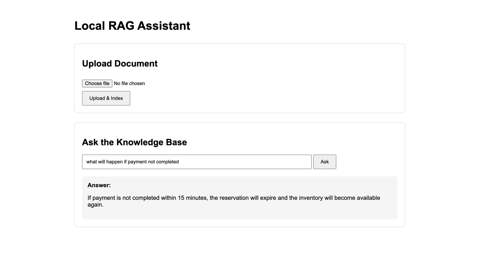

# RAG Application

Home Page: http://localhost:8080/



### Workflow
```
             BROWSER
                │
       Upload product.txt
                │
                ▼
       Spring MVC Controller
                │
                ▼
       DocumentIngestionService
       ------------------------
    1. Chunk the document
    2. Generate embedding using Ollama: nomic-embed-text
    3. Store embeddings in pgvector
                │
          User asks question
                │
                ▼
            RagService
           ------------
    1. Similarity search on pg vector
    2. Pass the context from similariy search and the question 
       to the Ollama:  llama3.2
                │
                ▼
             Answer
                │
                ▼
             Browser
```


### Connect to vector db
```bash
docker exec -it rag-postgres psql -U postgres -d ragdb
```


